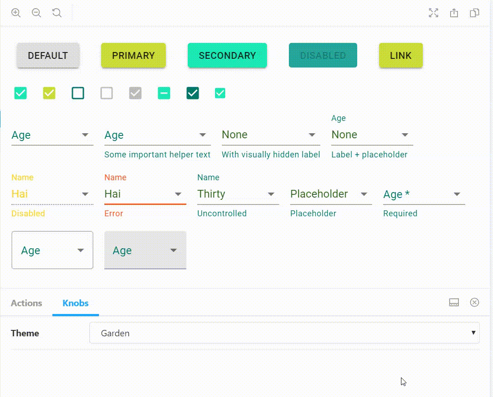

## Easily switch material-ui themes in storybook
You can read more here: https://medium.com/@aleksander_37591/easily-switch-material-ui-themes-in-your-storybook-474638bfc3f1


The Storybook Theme toolbar switches between Garden and RetroWave. The Material UI
controls retain their state when the theme changes.

```
npm ci
npm run storybook
```




Use Node 24. The application builds with Vite and Storybook uses its Vite renderer.
`package-lock.json` is the dependency lockfile. The obsolete Yarn lockfile and
Create React App toolchain were replaced to remove their vulnerable dependency chains.

Run `npm test`, `npm run build`, `npm run build-storybook`, and `npm run audit`
before submitting a change. `npm start` starts the application; `npm run storybook`
starts the component demo on port 9009.

After `npm exec -- playwright install chromium`, run `npm run test:browser`
to check the built theme toolbar, colors, control state, navigation, and actions.
